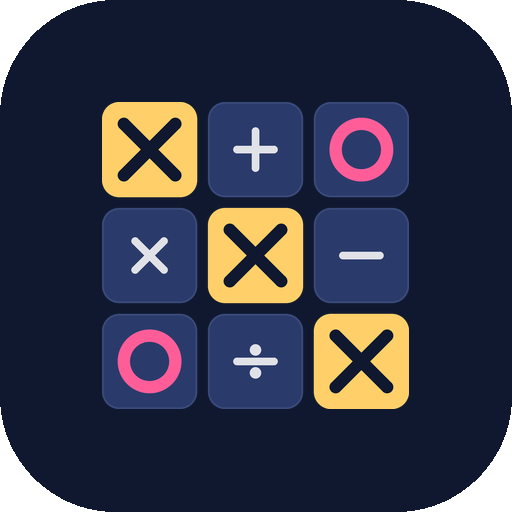
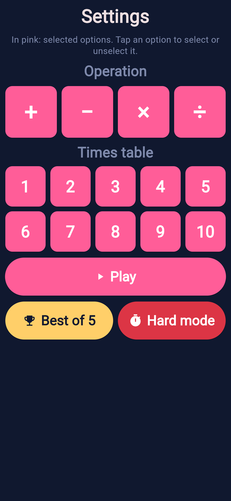
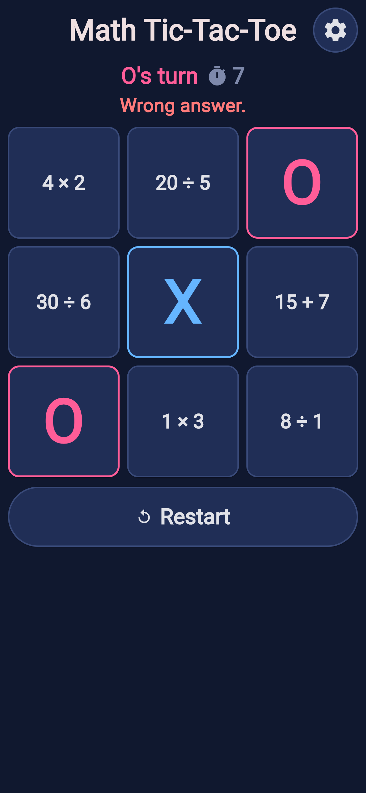
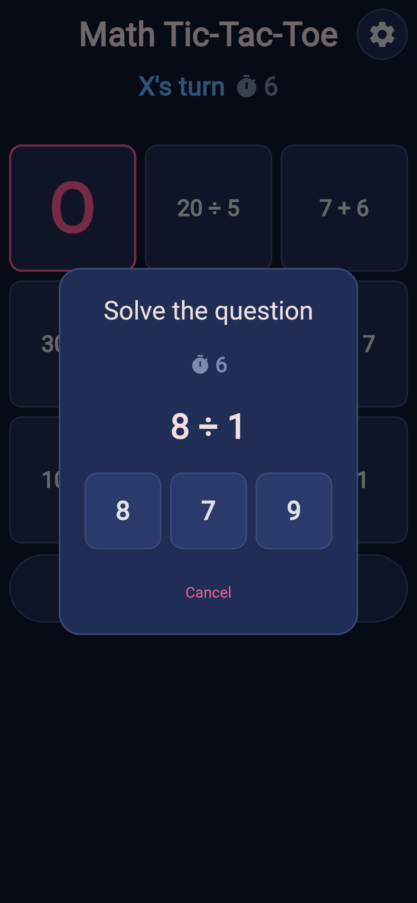
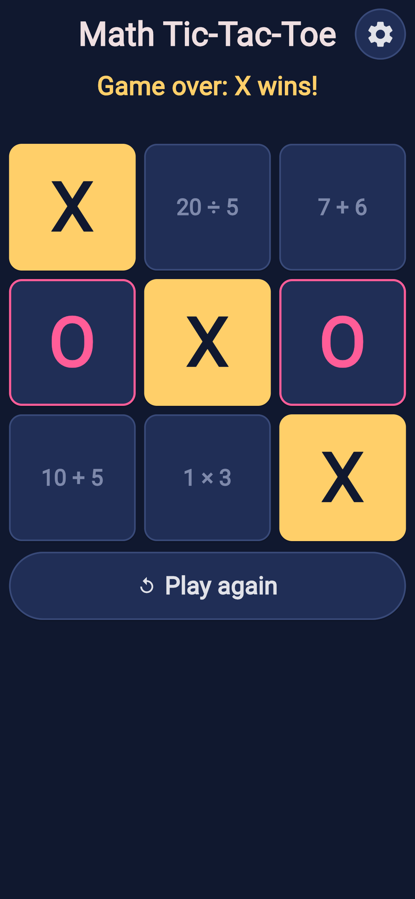
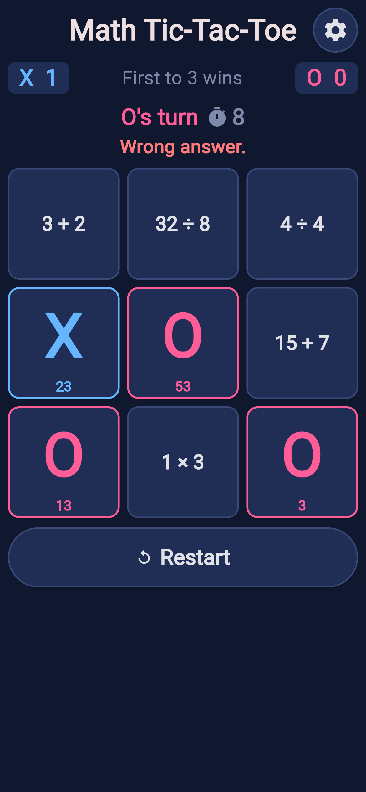
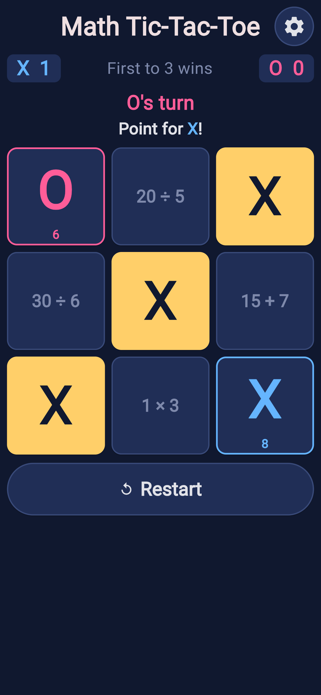
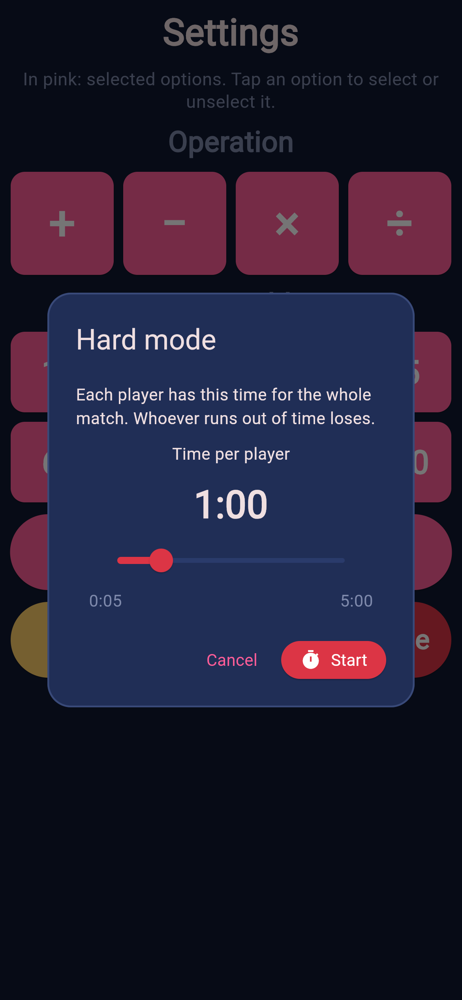
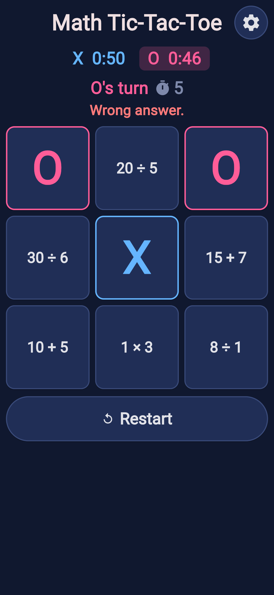

# Math Tic-Tac-Toe

A **mobile app** (Android and iOS) built in Python with Flet: tic-tac-toe where
every move requires solving a math question. Its Portuguese name is
*Cálculo da Velha*, a pun on *jogo da velha* (Portuguese for tic-tac-toe) and
*cálculo* ("calculation").

<p align="center">
  
</p>

## Screenshots

| Settings | A match | The question | A win |
| :---: | :---: | :---: | :---: |
|  |  |  |  |

| Best of 5 | Best of 5: a point | Hard mode | Hard mode match |
| :---: | :---: | :---: | :---: |
|  |  |  |  |

In Portuguese: [settings](docs/screenshots/pt-1-configuracoes.png) and
[a best of 5](docs/screenshots/pt-2-melhor-de-5.png). All screenshots are in
`docs/screenshots/` (1170 × 2532, a 390 × 844 phone at 3×).

## How to play

- The app opens on the **settings** screen (see below). Tap **Play** to start.
- Each cell of the 3x3 board shows a math question.
- Tap a cell: a modal shows the question and 3 possible answers.
- **Each turn has 10 seconds to choose a cell and answer its question.**
  The seconds left show next to whose turn it is (*"X's turn ⏱ 7"*) and,
  while a question is open, above it; they turn red in the last 3. When
  they reach zero, **"Time's up!"** (*"Tempo esgotado!"*) shows in red below
  the turn message and:
  - with a question open, the modal closes and it counts as a wrong answer
    (the other player's mark goes on that cell);
  - without one (no cell chosen), the turn simply passes.
  Each new turn gets 10 new seconds.
- Changed your mind? Tap **Cancel** (*Cancelar* in Portuguese) below the
  answers: the modal closes, nothing changes (it is still your turn and the
  cell keeps the same question) and you can choose another cell, **within
  the same 10 seconds**: canceling does not stop or restart them.
- Right answer: the cell gets your mark (X or O) and the turn passes.
  **Wrong answer: the cell gets the other player's mark** and the turn also
  passes. That mark counts like any other: if it completes the other
  player's line, they win (or, in a best of 5, score the point).
- Each player has a color: **X is blue, O is pink**. The message showing
  whose turn it is (*"Vez de X"*) changes to that player's color with each
  turn, like their marks on the board (a played cell is also outlined in
  its player's color) and their hard mode timer.
- A wrong answer shows **"Wrong answer."** (*"Resposta incorreta."*) **in
  red** below it. A right answer shows no message (the mark on the board is
  enough) and clears the previous one.
- When someone wins, the 3 cells of the winning line turn **gold**, and so
  does the message about the winner (*"Game over: X wins!"*). A draw's
  message keeps the normal color.
- A button below the board starts a new match with the same settings. It is
  always there, and its text tells what it does:
  - during a match: **Restart** (*Recomeçar* in Portuguese), to give up the
    current match and start over. Once someone has answered a question, a
    confirmation asks first (*"Restart the match? The current match will be
    lost."*): **Cancel** keeps playing, **Restart** starts over. Before the
    first answer there is nothing to lose, so it starts over right away;
  - once the match ends (win or draw): **Play again** (*Jogar novamente* in
    Portuguese).
- The **⚙ button** next to the title (or the phone's back button) returns to
  the settings screen. Tapping **Play** there starts a new match.
  Leaving throws the current match away, so during a match, once someone
  has answered a question, the ⚙ button asks first (*"Leave the match? The
  current match will be lost."*, in Portuguese *"Sair da partida? A partida
  atual será perdida."*): **Cancel** keeps playing, **Leave** (*Sair*) goes
  to the settings. Before the first answer, or once the match is over, it
  goes right away. (The phone's back button does not ask.)

## Best of 5

Best of 5 (*Melhor de 5*) plays for points: **the first player to score 3
points wins** (the majority of 5).

- On the settings screen, tap the gold **Best of 5** button, below **Play**
  (next to **Hard mode**). The game screen shows the score below the title:
  **X's points on the left, O's on the right**, each in its player's color,
  with *"First to 3 wins"* (*"Vence quem fizer 3"*) between them.
- Cells are played as usual: choose and answer within the turn's 10
  seconds. Right, your mark; wrong (or too late), the other player's mark;
  and the turn passes.
- **Each line scores a point**: first its 3 cells **turn gold** (with the
  scorer's marks) for 1 second, so everyone sees where the point was; the
  rest of the board waits meanwhile (nothing can be tapped). Then the gold
  cells are cleared (each gets a new question) and the match goes on with
  the other player's turn. The point is also announced below the turn
  message: *"Point for X!"* (*"Ponto para X!"*), in
  light text with the X in its color. **A move that completes two lines at
  once scores two points**: both lines turn gold and are cleared, and the
  message says *"2 points for X!"* (*"2 pontos para X!"*). When a wrong answer
  completes the other player's line, the message says both, in red: *"Wrong
  answer. Point for O!"* (or *"Time's up! Point for O!"*).
- **Played cells do not last**: once a cell gets a mark, a number shows very
  small below it, in **the color of that symbol** (blue X, pink O): **the
  biggest number of the question answered there** (4 × 8 = 32: 32 seconds;
  15 − 9 = 6: 15 seconds), at most 60 (70 ÷ 7: 60 seconds). It counts down
  (32, 31, 30, ...) in real time, whoever's turn it is. **When it reaches
  zero, the cell is open again** with a new question; the turn does not
  change. Cells without a symbol show no number.
- There are no draws: if the board is full, the player whose turn it is
  cannot choose a cell, so their 10 seconds run out and the turn passes
  until a cell opens.
- While a point shows in gold, no turn time runs: the next player's 10
  seconds start once the gold line disappears.
- **The third point wins the match** (if two points at once go past 3, the
  score stops at 3): its line (or both lines) turns gold and stays, the
  countdowns stop and the status says *"Game over: X wins!"*. **Play again**
  starts a new best of 5 (0 to 0); **Restart** and ⚙ work as usual.
- Best of 5 has no hard mode timers: it is a mode of its own. **Play**
  starts a normal match again.

## Hard mode

Hard mode plays against the clock, like chess: **each player has a fixed
amount of time for the whole match**, and whoever runs out of time loses.

- On the settings screen, tap the red **Hard mode** button (*Modo difícil*,
  white text) below **Play**, next to **Best of 5**. A window shows the **time per player** (*Tempo por
  jogador*), **1:00** to start with, above a red **bar**: slide it to choose
  from **0:05 (5 seconds) to 5:00 (5 minutes)**, in steps of 5 seconds. The
  ends of the bar show those limits. Nothing is typed, so the time is always
  valid. Then tap **Start** (*Começar*). **Cancel** goes back to the
  settings.
- The game screen shows both timers below the title, each in its player's
  color: **X on the left, O on the right**, as minutes:seconds. The timer of
  the player whose turn it is has a dark background tinted with their color,
  and a timer turns **red in its last 10 seconds**.
- Only the player whose turn it is loses time, including while the question
  window is open (thinking counts). Answering, right or wrong, passes the
  clock to the other player along with the turn.
- **When a timer reaches 0:00, that player loses** and the other one wins.
  The screen says it like any other win, *"Game over: X wins!"* (*"Fim de
  jogo: X venceu!"*), with the reason below in red: *"O ran out of time."*
  (*"O ficou sem tempo."*). In that message **only the symbol keeps its
  player's color** (a blue X or a pink O) so it is clear at a glance which
  player it is about. **All of the winner's cells turn gold**, as the
  winning line does in a normal win. If the question window was open, it
  closes: an answer after that does not count.
- The match can still end the usual way (three in a row or a draw); the
  clock then stops.
- **Play again** starts a new hard mode match with the same time, both
  clocks full again. **Restart** during a match works as usual.
- Leaving to the settings (⚙ or the back button) stops the clock. **Play**
  starts a normal match (no timers); the red button starts hard mode again.

## Settings

The settings screen chooses what the match practices. **Everything starts
selected**: all 4 operations and all 10 times tables.

- **Operation**: 4 square buttons, **+ − × ÷**.
- **Times table** (*Tabuada*): only shown when **×** or **÷** is selected.
  Buttons **1 to 10**.
- Selected options are **pink**; unselected ones are navy (dark blue). A
  small hint below the title explains this: *"In pink: selected options. Tap
  an option to select or unselect it."* (in Portuguese: *"Em rosa: opções
  selecionadas. Toque em uma opção para marcar ou desmarcar."*).
- **Each tap changes only the option tapped**: a selected option becomes
  unselected, an unselected one becomes selected. The other options never
  change. For example, with everything selected, tapping **5** removes only
  the 5 table.
- One option of each section always stays selected (tapping the last one
  does nothing), so the game always has questions to ask.

What each operation asks:

| Operation | Questions |
| --- | --- |
| + Addition | Numbers from 1 up to 10, 15 or 20 (the center of the board has the biggest numbers) |
| − Subtraction | Same numbers; the result is never negative |
| × Multiplication | The chosen tables: `7 × 1` to `7 × 10` for each one |
| ÷ Division | The chosen division tables: `7 ÷ 7` to `70 ÷ 7` (answers 1 to 10) for each one |

- With several operations, each question first picks one of them at random,
  so they appear about equally often (addition has hundreds of possible
  questions, a times table only 10).
- The 9 questions on the board are always different from each other, and a
  cell that opens again (best of 5) always gets a question that is not on
  the board. (A times table has 10 facts, so there is always one left.)
- Settings last while the app is open; they are not saved when it closes.

## Look

The colors follow the design in `docs/design/`: a **dark** app, whatever the
phone's light/dark setting. All of them live in `ui/styles.py`.

| Color | Used for |
| --- | --- |
| Dark navy `#10182F` | Background of every screen (and of the phone's system bars) |
| Navy `#202E56`, outlined in `#394A79` | Board cells, unselected options, dialogs, the restart and ⚙ buttons |
| Light navy `#2A3B6B` | Answer choices inside the question window |
| Near white `#E1E2E8` / grey blue `#7E89AB` | Texts / hints and section labels |
| Pink `#FF5D98` (white text) | Selected options, the Play button and the main button of a dialog |
| Blue `#65B5FF` / pink `#FF5D98` | Player X / player O |
| Gold `#FFCF69` (dark navy text) | The winner's cells (and a best of 5 point for 1 second), the winner's message, the Best of 5 button |
| Soft red `#FF7A7A` | Wrong answer, time's up, out of time, a timer's last seconds |
| Red `#DC3545` (white text) | The Hard mode and Start buttons, the hard mode time bar |

Square buttons (cells, options, answer choices) have rounded corners; the
Play, Best of 5, Hard mode and restart buttons are pills.

## Screen and orientation

- **Portrait only**: the app locks itself in vertical (portrait) orientation
  when it starts, so rotating the phone does not rotate the game.
- **Full width**: the board fills the whole screen width (minus an 8 dp
  margin). Cells stay square and every size on the screen (title, messages,
  board text, restart button) grows with the screen, so bigger phones and
  tablets get a bigger, proportional game.
- **Everything always fits**: the restart button can never be pushed off the
  screen. On screens that are not tall enough for a full-width board (iPads,
  unfolded foldables, square or landscape windows), the board shrinks just
  enough for the whole screen to fit, restart button included. That button
  is always shown (only its text changes), so nothing moves when a match
  ends. On phones in portrait the board always gets the full width. The
  space for the hard mode timers (which a best of 5 uses for its score) is
  counted in every mode, so switching modes never pushes anything off the
  screen (on an 800 × 1280 tablet the
  board is therefore a little narrower than the full width).
  The settings screen is always shorter than the game screen, so its Play,
  Best of 5 and Hard mode buttons are never hidden either: the last two
  share a row, and their icons and margins grow with the screen so their
  labels always fit.
- If the screen size or the system bars change (e.g. split screen), the
  layout adapts immediately.

Platform limits of the portrait lock (set by Android/iOS, not by the app):

- **Android 16+ on large screens** (tablets and foldables at 600 dp or wider)
  may ignore the lock; Android lets the user choose there.
- **iPad**: iOS only honors the lock if the app opts out of multitasking
  (Split View / Slide Over). This is not configured.
- The lock is applied when the app code starts, so the brief launch (splash)
  screen follows the system rotation.

## Languages

The app is available in **Portuguese** and **English** and picks the language
automatically from the phone settings:

- If the phone's primary language is Portuguese (any variant: `pt`, `pt-BR`,
  `pt-PT`, ...), the app is shown in Portuguese.
- In any other case (English, Spanish, unknown, ...), the app is shown in
  English.

The language is read once, when the app starts. To test the other language,
change the phone language and reopen the app. All texts live in
`src/math_tic_tac_toe/i18n/catalogs/` (one file per language).

## Requirements

- **Python 3.10 or newer** on your computer. Check with `python --version`
  (on macOS/Linux the command may be `python3`; on Windows you can also use
  the `py` launcher).
- **An Android or iOS phone** with the **Flet** app installed from Google Play
  or the App Store, to run the app during development.
- **Your computer and your phone on the same Wi-Fi network.**
- To build the installable app: see [Building the mobile app](#building-the-mobile-app).

## Setting up the environment

This project **always** uses a Python virtual environment (venv) named `.venv`
in the project root. Every command in this README assumes that environment is
**active**. Do not install the project in your global Python.

Why:

- Flet, its CLI, pytest, ruff and mypy stay isolated from other Python projects, so
  everyone works with the same dependency versions.
- Recent Linux distributions (e.g. Debian 12+, Ubuntu 23.04+) and Homebrew's
  Python refuse `pip install` outside a virtual environment
  (`externally-managed-environment` error, PEP 668).

No `.env` file or environment variables are needed.

### 1. Create the venv (once)

From the project root (the folder containing `pyproject.toml`):

```powershell
# Windows (PowerShell)
python -m venv .venv
```

```bash
# macOS / Linux
python3 -m venv .venv
```

This creates the `.venv` folder, which is already listed in `.gitignore`.

> On Debian/Ubuntu, if you get `ensurepip is not available`, install the venv
> module first: `sudo apt install python3-venv`.

### 2. Activate the venv (every new terminal)

```powershell
# Windows (PowerShell)
.venv\Scripts\Activate.ps1
```

```bat
:: Windows (cmd.exe)
.venv\Scripts\activate.bat
```

```bash
# macOS / Linux
source .venv/bin/activate
```

When it is active, the prompt starts with `(.venv)`. From then on, `python`,
`pip`, `flet`, `pytest`, `ruff` and `mypy` refer to the venv on every platform. If the
prompt does not show `(.venv)`, activate it before running anything else.

> If PowerShell refuses to run `Activate.ps1` ("running scripts is disabled on
> this system"), allow local scripts for your user and try again:
> `Set-ExecutionPolicy -Scope CurrentUser RemoteSigned`

> Editors: point VS Code / PyCharm to the interpreter in `.venv`
> (`.venv\Scripts\python.exe` on Windows, `.venv/bin/python` elsewhere) so
> their terminals, test runner and debugger use it too.

### 3. Install the project (once, and after dependency changes)

With the venv active:

```powershell
pip install --upgrade pip
pip install -e ".[dev]"
```

- `-e` (editable) installs the package in place, so code changes take effect
  without reinstalling.
- `[dev]` installs the development tools: the Flet CLI (`flet run`,
  `flet build`), pytest, pytest-cov, ruff and mypy.

Dependencies are declared in `pyproject.toml`:

- `dependencies`: what the app needs at runtime. **These are bundled into the
  mobile app**, so keep this list small.
- `[project.optional-dependencies] dev`: development tools only, never bundled.

After changing them, run the install command again.

### 4. Leave the venv

```powershell
deactivate
```

To start from scratch, delete the `.venv` folder and repeat steps 1 to 3.

## Running on your phone (development)

With the venv active, from the project root:

```powershell
# Android
flet run --android -r

# iOS
flet run --ios -r
```

1. The terminal prints a QR code.
2. Scan it with the phone camera; it opens the app inside the Flet app.
3. With `-r`, the app reloads on the phone whenever you save a file in `src/`.

`flet run` finds the app through `[tool.flet.app] path = "src"` in
`pyproject.toml`, which points to `src/main.py`.

> If the phone cannot connect, make sure both devices are on the same Wi-Fi
> network and that your computer's firewall allows incoming connections for
> Python.

### Quick preview on the computer (optional)

For fast iterations without the phone, `flet run --web -r` opens the app in
the browser. This is only a development shortcut: always check the result on
a phone, which is the target platform. In the browser the orientation is not
locked and the board fills the browser window width; use a narrow window or
the browser's device mode (F12, then "Toggle device toolbar") to see a phone
layout.

## Building the mobile app

`flet build` always needs the **target platform** right after `build`
(`apk`, `aab` or `ipa`). With the venv active, from the project root:

```powershell
# Android test build (first time: also installs Flutter, JDK and Android SDK)
flet build apk --yes
```

| Command | Output | Use | Build machine |
| --- | --- | --- | --- |
| `flet build apk` | `build/apk/` | Install directly on Android phones for testing | Windows, macOS or Linux |
| `flet build aab` | `build/aab/` | Upload to Google Play | Windows, macOS or Linux |
| `flet build ipa` | `build/ipa/` | Install on iPhones / upload to the App Store | macOS with Xcode only |

- On the first build Flet installs what is missing (Flutter SDK and, for
  Android, the JDK and the Android SDK). It asks for confirmation; add `--yes`
  after the platform (e.g. `flet build apk --yes`) to accept automatically.
  This takes a while and needs internet.
- Only `src/` (see `[tool.flet.app]` in `pyproject.toml`) and the runtime
  `dependencies` are packaged; tests, docs and the venv are not.
- The build bundles the newest Python version supported by Flet that matches
  `requires-python`. CI tests every version from 3.10 to 3.14 for that reason.
- Before publishing to the stores, set the app identity in `pyproject.toml`
  under `[tool.flet]`: `org` (e.g. `com.yourcompany`, which forms the bundle
  ID), `product` (name under the app icon) and `company`.

### App icon and launch screen

- The icon is `src/assets/icon.png`: a **transparent** 1024 × 1024 image of
  the board (the winning X line in gold, pink O's and the four operations).
  `flet build` generates every size each platform needs from it, with the
  margins their masks require, on the navy set as `icon_background` under
  `[tool.flet]` in `pyproject.toml`: flattened on iOS (the App Store rejects
  transparency), the adaptive icon's background on Android.
- The launch (splash) screen uses the same icon on that navy
  (`[tool.flet.splash]`, in light and dark mode), so the app does not flash
  white while it starts.
- To change the icon, replace `src/assets/icon.png` with another transparent
  square PNG (1024 × 1024 or more) and build again. A preview of the framed
  icon is `docs/screenshots/app-icon.png`.

### Troubleshooting

- **`flet build: error: the following arguments are required: target_platform`**:
  the platform is missing. Run `flet build apk` (or `aab` / `ipa`), not just
  `flet build` or `flet build --yes`.
- **`flet: command not found`** / **`'flet' is not recognized`**: the venv is
  not active, or the dev tools are not installed. Activate the venv and run
  `python -m pip install -e ".[dev]"`.

## Quality checks

With the venv active:

```powershell
ruff check --fix .   # lint, sort the imports (isort) and apply automatic fixes
ruff format .        # format the code (Black style)
mypy                 # strict type checking of src/ and tests/
pytest               # tests + coverage report
```

Run all four before committing; CI runs the same checks and fails if any of
them reports a problem (for formatting, it runs `ruff format --check`).

### Code conventions

The tools enforce them, configured in `pyproject.toml`:

- **Imports** are sorted by ruff's isort rule (`I`), in three groups:
  standard library, third party (`flet`, `pytest`), then this project
  (`math_tic_tac_toe`, `tests`). There is no separate `isort` tool: ruff
  implements the same rules, so the two never disagree.
- **Formatting** is done by `ruff format` (the Black style, 100-character
  lines). Only the winning-lines grid in `game.py` opts out
  (`# fmt: off`), to keep its rows / columns / diagonals layout.
- **Lint rules** cover errors, likely bugs, naming, modern syntax,
  simplifications, comprehensions, return statements, pathlib, performance,
  leftover `print()` calls, pytest style (e.g. `pytest.raises` always checks
  the message with `match=`), type annotations everywhere, and unused or
  blanket `noqa` / `type: ignore` comments. The math symbols `×` and `−`
  shown to players are allowed in strings.
- **Types**: every function is annotated and `mypy --strict` passes. In the
  tests, only the errors caused by Flet's loosely typed control tree are
  turned off (see `[tool.mypy]`). Tests hand their fake page to the app
  with `FakePage.as_page()` instead of `type: ignore` comments, and tap
  controls with `click(control)`; both live in `tests/support.py`.
- **Dialogs and screens**: never switch screens while a dialog is still
  closing. In Flet, `pop_dialog()` only starts closing a dialog; Flutter keeps
  it attached to the screen it was opened on until its animation ends, so a
  screen change at that moment leaves it behind, stuck open. Anything that
  switches screens after a dialog must run from the dialog's `on_dismiss`
  (as the hard mode dialog does). The tests' `FakePage` follows the same
  rules and fails if a screen changes while a dialog is closing; call
  `page.finish_closing_dialogs()` to simulate the end of the animation.

### Test coverage

Every `pytest` run measures line and branch coverage of `src/` and prints the
lines that are not covered. **The run fails if total coverage is below 90%**
(`fail_under` in `[tool.coverage.report]`, `pyproject.toml`), even if every
test passes. New code must come with tests.

To browse the uncovered lines in detail, generate an HTML report and open
`htmlcov/index.html`:

```powershell
pytest --cov-report=html
```

### Continuous integration

The same checks run on GitHub for **every push to any branch and every pull
request** (`.github/workflows/ci.yml`):

- **Lint, format and types**: `ruff check` (problems shown inline on the
  commit/PR), `ruff format --check` and `mypy`.
- **Pytest**: the test suite with the 90% coverage minimum, on Python 3.10,
  3.11, 3.12, 3.13 and 3.14. The coverage table is shown on the run's summary
  page.

CI also creates a venv and installs with `pip install -e ".[dev]"`, exactly as
described above. Ruff and mypy are pinned to exact versions in
`pyproject.toml`, so local and CI results always match; upgrade them on
purpose.

The game core (`game.py`) does not depend on Flet, so the rules are tested
without running the app. The screen is tested too: `tests/test_app.py` starts
the real app on a fake page and plays full matches by tapping its controls. The current interface is only the first skeleton;
game modes, a computer opponent, stealing, profiles and a scoreboard will be
added in the next steps.

## Project structure

```
.github/workflows/ci.yml      CI: lint, format, types, tests and coverage on every commit
pyproject.toml                dependencies, Flet, pytest, ruff and mypy settings
src/                          everything packaged into the mobile app
  main.py                     mobile entry point (flet run / flet build)
  assets/icon.png             app icon (flet build makes every size from it)
  math_tic_tac_toe/           the game package
docs/design/                  the design the app's colors follow
docs/screenshots/             screenshots of the app and a preview of its icon
tests/                        pytest suite (a package)
  support.py                  helpers shared by the tests (fake page, click, ...)
```

Each module in `src/math_tic_tac_toe/` has a single responsibility:

| Module | Responsibility |
| --- | --- |
| `game.py` | Game rules: board, turns, a wrong (or late) answer giving the cell to the other player, victory (and its winning line), draw, running out of time, end of match, no repeated questions on the board; best of N: points per line, cleared lines, how long a played cell lasts and its reset. Language-agnostic. |
| `settings.py` | What players choose: any combination of operations (+ − × ÷) and times tables (1 to 10), everything by default; the hard mode time limit; and best of N (5). |
| `clock.py` | Hard mode chess clock: each player's remaining time, running only on their turn and following the match's turns; and the 10-second countdown of each turn (no Flet; the time source can be replaced in tests). |
| `problems.py` | What can be asked: every problem of each operation (+ and − by difficulty, × and ÷ from the chosen tables). |
| `questions.py` | How it is asked: picks a problem for a cell (fairly across operations, without repeats on the board) and builds its answer choices; the biggest number of a question. |
| `cell_timers.py` | Best of N: each played cell's countdown, in real time, until it is open again (no Flet; the time source can be replaced in tests). |
| `app.py` | Builds the app: detects the language, creates both screens and wires them together. |
| `i18n/language.py` | Supported languages and mapping of a device code (`pt-BR`) to one of them. |
| `i18n/text_key.py` | Identifiers of every text shown to the user. |
| `i18n/catalogs/` | One file of texts per language, plus the registry. |
| `i18n/translator.py` | Looks up and formats texts in one language. |
| `ui/device_language.py` | Asks the phone which language it uses. |
| `ui/orientation.py` | Locks the app in portrait on phones (no-op on web/desktop). |
| `ui/layout.py` | Computes every size from the screen size: full-width board, never hiding the restart button (no Flet). |
| `ui/responsive.py` | Reads the screen size and system bars; applies the layout again when they change. |
| `ui/presenter.py` | Turns the game state into translated display data (no Flet). |
| `ui/ports.py` | Interfaces the controller expects from the screen, grouped in `Screen` (no Flet). |
| `ui/controller.py` | Connects screen events to the game rules; starts new matches (with new settings on Play); asks before a match in progress is lost; shows a best of 5 point in gold for 1 second; runs the hard mode clock, the best of 5 cell countdowns and each turn's 10 seconds. |
| `ui/screens.py` | Common frame of both screens (margins, safe area, centering, scrolling). |
| `ui/navigator.py` | Switches between the settings and the game screens (back button included). |
| `ui/settings_view.py` | Settings screen: operation buttons, times table buttons, the Play button, and the gold Best of 5 and red Hard mode buttons side by side. |
| `ui/hard_mode_dialog.py` | Modal of the Hard mode button: time per player chosen on a bar from 0:05 to 5:00 (1:00 by default) and Start. |
| `ui/timers_view.py` | Hard mode: both players' timers below the title (hidden in normal matches). |
| `ui/score_view.py` | Best of 5: both players' points below the title, in the timers' place (hidden otherwise). |
| `ui/ticker.py` | Background loop that drives the hard mode clock a few times per second. |
| `ui/game_header.py` | Top of the game screen: the title and the ⚙ settings button. |
| `ui/title_view.py` | A screen title (single line, sized by the layout). |
| `ui/board_view.py` | Draws the 3x3 board of square buttons across the full width, with the winning line in gold and, in a best of 5, each played cell's seconds, counting down in its mark's color (open cells show none). |
| `ui/question_dialog.py` | Modal showing the seconds left on the turn, the question and 3 answer choices. |
| `ui/turn_time_view.py` | The seconds left on the turn (timer icon and number, red at the end), next to whose turn it is and in the question modal. |
| `ui/status_view.py` | Shows whose turn it is (in that player's color, with the turn's seconds) or the winner (in gold) and, in red, a wrong answer or a player out of time (a best of 5 point in light text). |
| `ui/confirm_dialog.py` | Confirmation modal shown before the restart or ⚙ button throws away a match in progress; it acts once it has finished closing. |
| `ui/restart_button.py` | Restart button as wide as the board: "Restart" during a match, "Play again" after it. |
| `ui/square_button.py`, `ui/styles.py` | The design's colors (`docs/design`) and the shared looks: theme, square buttons, pills, dialogs; player, feedback and hard mode colors; fixed dialog sizes. |
| `ui/events.py` | Adapts Flet's event handlers to plain callbacks (`ignoring_event`). |

Only the `ui/` modules (except `presenter.py` and `ports.py`) import Flet. The
controller depends on the interfaces in `ui/ports.py`, so it is tested with
fake screens (`tests/test_controller.py`).

### Adding a language

1. Add it to `Language` in `i18n/language.py` (e.g. `SPANISH = "es"`).
2. Create `i18n/catalogs/spanish.py` with a text for every `TextKey`.
3. Register it in `CATALOGS` in `i18n/catalogs/__init__.py`.

The tests in `tests/test_i18n.py` fail if a language has no catalog or a
catalog misses a text.
